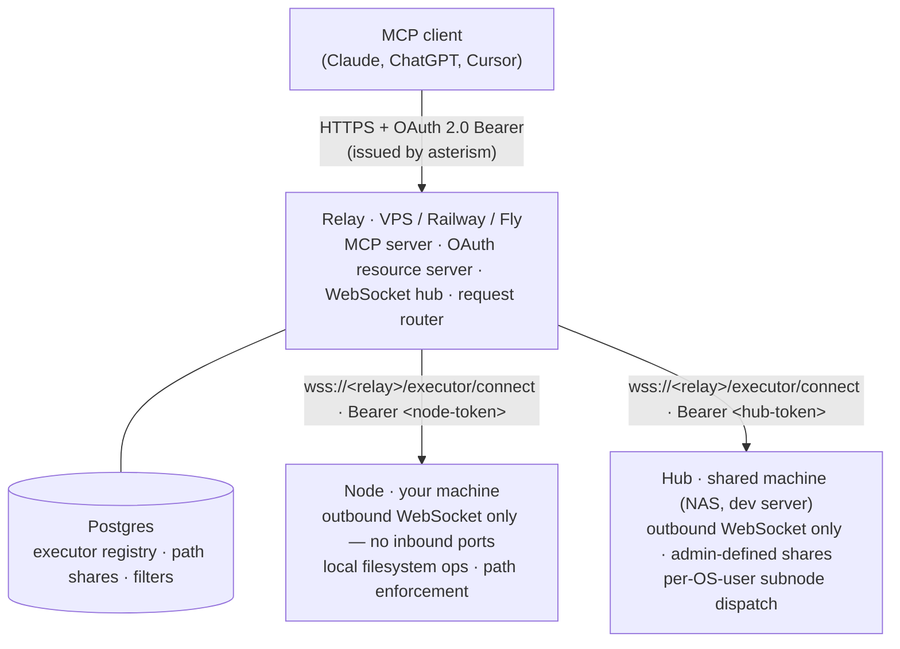

# Architecture

- [Design Philosophy](#design-philosophy)
- [Components](#components)
- [Relay](#relay)
- [Node](#node)
- [Hub](#hub)
- [MCP Connection](#mcp-connection)
- [Security](#security)

---

## Design Philosophy

**The node is the security boundary.** The relay routes requests but cannot grant the node access to any path it has not explicitly permitted in its local config. A compromised relay can restrict or replay requests, but it cannot expand the node's filesystem access.

**No inbound ports on the node.** The node connects outbound to the relay over WebSocket and holds that connection open. There is nothing to expose, nothing to firewall, and no IP to keep stable. The relay is the only component that needs a public address.

**CLI-first.** Every action — node setup, path management, token rotation, relay administration — is accessible from the command line. The GUI and any future web UI are convenience layers on top of a complete CLI; nothing requires them.

**All config is local to the node.** The node reads `node.yaml` and `paths.yaml` from disk at startup. The relay stores a copy of path shares for routing and display, but that copy is always derived from what the node pushes — it is never authoritative. If the relay's copy diverges from the node's local config, the node's config wins at enforcement time.

**Reconnection is stateless.** Because all persistent config lives in either the local filesystem (node) or Postgres (relay), a node reconnect requires nothing beyond token validation. No handshake, no re-registration, no re-delivery of state.

---

## Components



| Component | Runs where | Responsibility |
|---|---|---|
| Relay | VPS, Railway, or Fly | MCP server, OAuth resource server (verifies asterism tokens), WebSocket hub, request routing, liveness tracking |
| Node | Any machine, under the user's own identity | WebSocket client, filesystem operations, path enforcement |
| Hub | A machine shared by multiple users, under a dedicated service identity | WebSocket client, OS-identity resolution, per-user subnode dispatch, admin-defined share permissions |
| Postgres | Sidecar to relay | Executor registry, path shares, path filters |

**Stack:** TypeScript throughout. Relay on Node.js; node distributed as a standalone `constellation` binary. Prisma for database access and migrations. Pino for structured logging.

---

## Relay

The relay has three layers that operate in sequence on every MCP tool call.

### OAuth layer

The relay is an OAuth 2.0 resource server. [asterism](adr/0022-asterism-authorization-server.md), an external OAuth 2.1 authorization server, owns sign-in, local accounts, groups, consent, grants and revocation, and issues JWT access tokens. The relay verifies each token (signature, issuer `ASTERISM_ISSUER`, expiry, audience `<RELAY_URL>/mcp`) with `@mahasamuha/asterism-verify`. It stores no sessions and no OAuth tokens, and creates a `users` row the first time it sees a token's `sub`.

The relay advertises itself with RFC 9728 protected resource metadata, which names asterism as the authorization server and declares three scopes: `relay` (use the tools and your own resources), `admin` (fresh sign-in only: hub registration, hub-share configuration, the admin activity log) and `register` (fresh sign-in only: permanently connect a computer). Admin means the token holds the `admin` scope (a fresh sign-in) and its `groups` contain `ADMIN_GROUP` (default `constellation-admins`). The node, relay CLI and hub identify themselves to asterism with Client ID Metadata Documents the relay serves at `/clients/*.json`.

Nodes and hubs register with `POST /api/executors/register`, authenticated by an access token that holds the `register` scope (a hub also needs `admin`). Every other `/api` route accepts only tokens issued to the CLI client, so MCP clients are limited to `/mcp`. The relay mints a long-lived executor token for the WebSocket connection: a 32-byte cryptographically random value stored as a SHA-256 hash and never logged in plaintext.

### WebSocket hub

Executors connect to `/executor/connect` with their executor token in the `Authorization` header. The relay validates the token, then holds the connection in an in-memory map keyed by `executorId`. Only one WebSocket per executor is permitted — a new connection from the same executor terminates the previous one (assumed stale).

The relay pings each connected executor every `HEARTBEAT_INTERVAL_SECONDS` (default 60s). The executor's WebSocket library responds with a pong automatically. Each pong updates `last_heartbeat_at` in Postgres. After `HEARTBEAT_MAX_MISSED` (default 3) consecutive missed pongs, the relay terminates the connection.

On connect, the executor immediately sends a `config_update` message with its current path shares. The relay upserts those shares in Postgres — adding new ones, updating paths on existing ones, removing any not present in the payload. This keeps routing information current without requiring a restart.

### Request router

When an MCP client calls a tool, the relay:

1. Resolves the Bearer token to a `user_id`
2. Resolves the `share` (and optional `host`) to a target `executor_id` and `absolute_root` path
3. Applies relay-side deny filters (glob or regex patterns)
4. Looks up the live WebSocket for that executor
5. Forwards an RPC envelope: `{ request_id, tool, absolute_root, params: tool_params }`
6. Waits up to `RPC_TIMEOUT_MS` (default 30s) for a response
7. Returns the result or a structured error to the MCP client

The relay passes `absolute_root` — the resolved filesystem path — directly in the RPC envelope. The node never sees share names; it only validates paths. This means the relay cannot fabricate a root the node doesn't know about: it can only route to paths that exist in the node's local `paths.yaml`.

If the executor disconnects while an RPC is in flight, the relay immediately rejects all pending requests for that executor. Operations are not retried; any mid-flight filesystem op is left in its current state.

### Data model

```
users            id, created_at
executor_tokens  id, user_id, token_hash, last_used_at, revoked_at
executors        id, user_id, executor_token_id, host, last_heartbeat_at
path_shares      id, user_id, executor_id, share, reported_path  [UNIQUE (user_id, share)]
hub_shares       id, executor_id, share, reported_path, permission_blob  [UNIQUE (executor_id, share)] — admin-defined, synced from a hub's config
relay_path_filters   id, user_id, scope_executor_id, pattern, pattern_type
`users` holds only the id (the asterism `sub`) and its relations; identity attributes come from the access token. `revoked_at` on `executor_tokens` is nullable; `IS NOT NULL` is the revocation check.

---

## Node

### Connection

On startup the node connects to `wss://<relay_url>/executor/connect` with `Authorization: Bearer <node_token>`. It immediately sends a `config_update` with the current `paths.yaml`, then enters a receive loop waiting for RPC envelopes and control messages.

**Reconnect backoff:** starts at 1 second, doubles on each failure up to 60 seconds, with ±20% jitter. Reconnects indefinitely. Because all config is local, reconnection requires no handshake beyond token validation.

**TLS enforcement:** the node refuses to connect over `http://` (or `ws://`) to any host that is not `localhost`, `127.0.0.1`, or `::1`. The node token is a long-lived credential; transmitting it unencrypted to a remote host is not permitted.

### Request handling

For every incoming RPC:

1. Validate `absolute_root` against the local `paths.yaml` allowlist — exact match required
2. Resolve the full path: `fs.realpath(absolute_root + relative_path)` (follows symlinks, canonicalises `..`)
3. Confirm the resolved path is prefixed by the resolved root — rejects traversal and symlink escapes
4. Execute the operation
5. Return `{ request_id, result }` or `{ request_id, error }`

For cross-share `copy` and `move`, the relay also supplies `dst_root`. The node validates `dst_root` against the allowlist and applies the same traversal check against it for `dst_relative_path`. For write targets that don't exist yet, the nearest existing parent is resolved and the suffix reconstructed — so new files can be created within the root without bypassing the check.

### Token rotation

Token rotation is node-initiated — the relay cannot push a new token unsolicited:

1. Node sends `{ type: "rotate_token" }` over the existing WebSocket
2. Relay generates a new token, stores it, returns `{ type: "token_rotated", token: "<new>" }`
3. Node writes the new token to `node.yaml` and reconnects
4. Relay revokes the old token atomically on successful reconnect with the new token

The node has a 5-minute window to reconnect. If it does not, the new token is revoked and the old token continues to work — no lockout occurs. If both tokens are independently revoked during the window, the node must re-run `constellation node init`.

### Config

```
~/.config/constellation/      (Linux/macOS)
%APPDATA%\constellation\      (Windows)
  node.yaml        — relay URL, node token, host name, max_file_size_kb
  paths.yaml       — path share definitions
  relay-session.yaml  — relay CLI session (written by constellation relay login)
```

Config files are read at startup. The node does not watch them for changes. `constellation node sync` sends a fresh `config_update` mid-session after a manual edit. `node paths add` and `node paths remove` modify `paths.yaml` and sync immediately.

---

## Hub

A hub is the deployment mode for a machine shared by multiple users — a NAS, a dev server, a domain-joined host. It connects to the relay the same way a node does (outbound WebSocket to `/executor/connect`), but differs in who controls what and how requests are executed:

| | Node | Hub |
|---|---|---|
| Runs as | The user's own OS identity | A dedicated low-privilege service user |
| Share registry | User-managed, pushed via `config_update` | Admin-defined in a config file the hub operator controls |
| Token type | Bound to one user (`ExecutorTokenType.NODE`) | Service-level (`ExecutorTokenType.HUB`), not bound to any user |
| Executing a request | Always runs as the connected user | Resolves the requesting user's OS account, then dispatches to a per-user **subnode** worker process running under that identity |

Because the hub's token isn't tied to a single user, the relay forwards the caller's identity (`user_sub`, `user_groups`, `user_claims`) in the RPC envelope so the hub can resolve who's actually asking. The hub maps that identity to a local OS username via a priority chain (custom claim → explicit `sub` → username map → opt-in `preferred_username`), then forks or reuses a worker that has `setuid()`'d to that user before touching the filesystem — so OS file permissions, not the hub process's own privilege, are what ultimately gate access within a share.

Permission evaluation happens twice: optimistically at the relay (the synced `hub_shares.permission_blob`, same `default` + per-`sub` or per-`group` `overrides` shape used for node shares) and authoritatively at the hub (full identity resolution against the admin config). The hub's decision always wins — the relay's check exists only to avoid an unnecessary round-trip for requests that are obviously going to be rejected.

Full deployment, identity-resolution, UID/GID security model, and config reference: [docs/hub.md](hub.md). Hub-specific design decisions are in `docs/adr/0009-hub-nullable-user-id.md`, `0010-hub-three-tier-identity.md`, and `0013-hub-restart-only-config.md`.

---

## MCP Connection

The relay exposes protected resource metadata (RFC 9728) at `/.well-known/oauth-protected-resource/mcp`. MCP clients that support OAuth discovery (Claude, ChatGPT, Cursor) follow it to asterism automatically when the relay URL is added to their config — no manual OAuth setup is required.

**First connection flow:**
1. Client calls `POST /mcp` without a token; the relay returns `401` with `WWW-Authenticate: Bearer ... resource_metadata="<relay>/.well-known/oauth-protected-resource/mcp"`
2. Client fetches the protected resource metadata, which names asterism as the authorization server and lists the `relay` scope
3. Client discovers asterism's endpoints from its own metadata and identifies itself (a Client ID Metadata Document URL or asterism's registration)
4. Client sends the user to asterism (with PKCE), where they sign in and approve the connection
5. Client exchanges the code for tokens at asterism's token endpoint
6. Client calls `POST /mcp` with `Authorization: Bearer <access_token>`; the relay verifies it and creates the user row if the `sub` is new

Refreshing tokens and revoking grants happen in asterism. For an admin-gated call the relay answers `403 insufficient_scope`, and the client asks asterism for a token with the `admin` scope.

**Adding the relay to an MCP client:**

| Client | Config |
|---|---|
| Claude (claude.ai) | Settings → Integrations → add `https://<relay>/mcp` |
| ChatGPT | Settings → Apps & Connectors → Add new connector (Pro/Team/Enterprise/Edu only) |
| Cursor | `.cursor/mcp.json`: `{ "mcpServers": { "constellation": { "url": "https://<relay>/mcp" } } }` |

---

## Security

### Trust model

| Layer | Can grant access | Can restrict access |
|---|---|---|
| Node local config (`paths.yaml`) | Yes — sole authority | Yes |
| Relay path filters | No | Yes — deny-only overlay |
| Node runtime check | — | Always enforced, independent of relay |

The relay resolves a share to an `absolute_root` and forwards it to the node. The node independently validates that root against its own `paths.yaml`. Because the node holds the allowlist locally, a compromised relay cannot forge a root the node doesn't recognise — it can at most send a path the node will reject.

Relay path filters are a further restrict-only layer. The relay pre-checks them before an RPC is dispatched and sends them in the envelope; the executor enforces them again on resolved real paths. They cannot grant access to anything the node would otherwise allow.

### Path validation

Two checks run in sequence before every operation:

**1. Root allowlist check** — the `absolute_root` in the RPC envelope must match a path in `paths.yaml` exactly. Any other value is rejected with `"Path rejected by node"` — deliberately terse; no internal path info is forwarded to the MCP client. Full detail (`tool`, `absolute_root`) is logged for operator troubleshooting only.

**2. Traversal and symlink check** — every path field in the RPC (`relative_path`, `src_relative_path`, `dst_relative_path`) is resolved via `fs.realpath()`, which follows symlinks and canonicalises `..`. If the resolved path does not begin with the resolved root, the request is rejected. This prevents both `../` traversal and symlink escapes that point outside the share root.

This check only covers the path supplied in the RPC — it does not re-run on entries discovered while recursively walking a directory for `copy`/`move`. A symlink found during that walk is therefore never dereferenced or recreated at the destination; it's skipped outright, since the executor has no way to re-validate where it points against the share root.

### Token security

- Executor tokens are 32-byte cryptographically random values, encoded as 64-character hex strings. OAuth access tokens are issued and signed by asterism and verified by the relay; it stores none
- Stored in Postgres as SHA-256 hashes; never logged in plaintext
- Node tokens are long-lived credentials — `node.yaml` and `relay-session.yaml` should be `chmod 600`
- The node refuses to transmit its token over an unencrypted connection to a non-localhost host

### Rate limiting

Every request — every MCP tool call and every HTTP route — hits exactly one rate-limit
bucket, decided by an explicit classifier (`classifyTool` in `router.ts` for tool
calls, `classifyHttpRoute` in `rate-limit-classify.ts` for HTTP routes). A request
gets a named, more permissive bucket only by being listed explicitly in one of those
two functions; anything not listed — a new tool, a new route, added later and never
classified — falls through to the strictest bucket in its dimension (expensive tools
for tool calls, the default bucket for HTTP routes) rather than skipping rate limiting
entirely. This is deliberate: the failure mode for forgetting to classify something
new is "rate limited too aggressively," never "not rate limited at all."

| Surface | Default | Config variable |
|---|---|---|
| MCP tool calls (standard tools) | 60 req/min per user | `RATE_LIMIT_TOOL_CALLS_PER_MIN` |
| MCP tool calls (expensive tools — `grep_files`, `find_files`, recursive `list_directory`, **and any unclassified tool**) | 20 req/min per user | `RATE_LIMIT_EXPENSIVE_TOOLS_PER_MIN` |
| Discovery metadata and client metadata documents (`/.well-known/oauth-protected-resource/*`, `/clients/*.json`) | 300 req/15 min per IP | `RATE_LIMIT_STATIC_PER_15MIN` |
| Any other HTTP route, including `/api/executors/register` — **and any route added later and not explicitly classified** | 10 req/15 min per IP | `RATE_LIMIT_DEFAULT_PER_15MIN` |
| `/api/*` (except registration), failed or unauthenticated requests | 10 req/15 min per IP | `RATE_LIMIT_DEFAULT_PER_15MIN` |
| `/api/*` (except registration), authenticated requests | 600 req/15 min per user | `RATE_LIMIT_API_PER_USER_PER_15MIN` |
| `/mcp`, failed or unauthenticated requests | 300 req/15 min per IP | `RATE_LIMIT_MCP_FAILED_PER_15MIN` |
| `/mcp`, every authenticated request (tool call or not) | 300 req/min per user | `RATE_LIMIT_MCP_REQUESTS_PER_MIN` |
| Executor WebSocket reconnects | 10 req/min per executor token | `RATE_LIMIT_WS_RECONNECT_PER_MIN` |

**Caveat: the defaults are sized for a single-user relay.** The relay no longer handles sign-in, so connecting a client costs it only a discovery request (the static bucket) and later `/api/*` calls (per user). `/mcp` and `/api` count only failed requests per IP, so a shared NAT or hosted MCP client's egress address isn't locked out; authenticated requests are counted per user, and `/mcp` tool calls additionally by the tool-call limiter. Authorization endpoints are asterism's and are limited there.

**Multi-user deployments belong behind a WAF.** The built-in limiter is in-memory, per-instance, and keyed only on IP. Use it for single-user deployments, prototyping and pilots. A multi-user production deployment should sit behind a WAF or an equivalent dedicated rate-limiting and abuse-protection tool (e.g. a cloud WAF, an API gateway, or a reverse proxy with rate-limiting and bot rules), as a security measure as well as for capacity.

Several users connecting at once from the same office NAT, VPN exit, or hosted MCP client will exhaust the per-IP buckets for failed requests quickly only if they fail; successful authenticated `/api` and `/mcp` requests are counted per user. Whether you size the WAF's rules or raise `RATE_LIMIT_DEFAULT_PER_15MIN` for a pilot, start from the number of `/api/*` calls you expect per IP in 15 minutes and add headroom for retries. Client SDKs differ in how many discovery URLs they probe, so verify against your relay's access logs.

`/healthz` is deliberately outside the dispatcher's buckets (an infra liveness check with its own generous limiter). `/mcp` and `/api` are not exempt: per IP they count only failed requests, and authenticated requests are limited per user (see the table).

Rate limit state is in-memory — no Redis required. State is lost on relay restart, which is acceptable.

### Account deactivation

The relay has no account state of its own. Disabling a user or revoking a client's grant is done in asterism, and takes effect when the access token the client holds expires. To cut off a node or hub immediately, revoke its executor token (`DELETE /api/executors/:id/token`), which terminates its connection.
